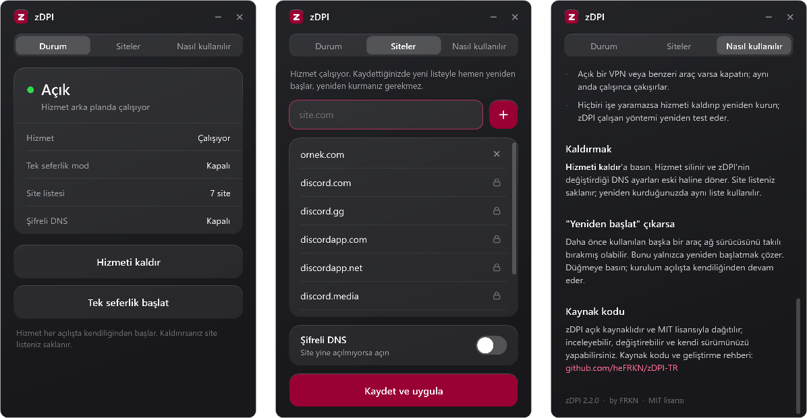

<div align="center">


# zDPI-TR

**Engellenen sitelere VPN olmadan erişim. Tek pencere, tek tık.**

[](https://github.com/heFRKN/zDPI-TR/releases/latest)
[](https://github.com/heFRKN/zDPI-TR/releases)
[](#gereksinimler)
[](LICENSE)

**[İndir](https://github.com/heFRKN/zDPI-TR/releases/latest)** ·
[Kullanım](#kullanım) ·
[Sorun giderme](#sorun-giderme) ·
[Kaynak kodu](#kaynak-kodu-ve-geliştirme) ·
[English](#english)

<br>



</div>

---

zDPI, internet sağlayıcısının bağlantının ilk paketindeki alan adına (SNI) bakarak uyguladığı engelleri aşar.
Trafiğiniz başka bir sunucuya gitmez; yalnızca ilk paket araya giren filtrenin okuyamayacağı şekilde düzenlenir.
Bu yüzden hızınız ve ping'iniz değişmez, oyunlar etkilenmez.

- **Kur ve unut:** Hattınızda çalışan yöntemi 13 yöntem arasından kendisi bulur, Windows hizmeti olarak kurar.
  Her açılışta arka planda başlar, çökerse kendini yeniden başlatır.
- **Site listesi:** Açmak istediğiniz siteyi yazın, kaydedin. Hizmet birkaç saniyede yeni listeyle yeniden başlar;
  yeniden kurulum gerekmez. Alt alan adları otomatik dahildir.
- **Tek seferlik mod:** Kurulum yapmadan, pencere açık kaldığı sürece tüm engelli sitelerde çalışır.
- **Şifreli DNS:** Adres düzeyinde de engellenen siteler için tek anahtar.
- **Hafif:** ~70 KB, ek kurulum gerektirmez, boştayken işlemci kullanmaz.

## Kullanım

1. **[Son sürümü indirin](https://github.com/heFRKN/zDPI-TR/releases/latest)** (`zDPI-vX.Y.Z.zip`).
2. Zip'e sağ tıklayıp **Tümünü ayıkla** deyin. Zip'in içinden çalıştırmak işe yaramaz.
3. Çıkan klasördeki **`zDPI.exe`**'yi açın, yönetici iznine **Evet** deyin ve **Hizmeti kur**'a basın.
4. 1-2 dakika bekleyin. Durum **Açık** olduğunda bitti.

**Site eklemek:** **Siteler** sekmesinde adresi yazın (ör. `site.com`; link yapıştırmak da olur) ve
**Kaydet ve uygula**'ya basın. Site hâlâ açılmıyorsa aynı ekrandan **Şifreli DNS**'i açın.

Ayrıntılı anlatım uygulamadaki **Nasıl kullanılır** sekmesindedir.

> [!TIP]
> Kurulum çalışma dosyalarını korumalı `C:\Program Files\zDPI` klasörüne kopyalar. İndirdiğiniz klasörü
> silmeyin; site eklemek veya hizmeti kaldırmak için `zDPI.exe` ile `core` klasörüne yine ihtiyacınız olacak.

### İki mod

| | Hizmet | Tek seferlik |
| :-- | :-- | :-- |
| Kurulum | Bir kez | Yok |
| Ne zaman çalışır | Her açılışta, arka planda | `zDPI.exe` açık kaldığı sürece |
| Hangi siteler | **Siteler** listesindekiler | Tüm engelli siteler |
| DNS | Siz açmadıkça dokunmaz | Gerekirse şifreli DNS açar |

Tek seferlik mod açıkken kurulu hizmet duraklar; pencere kapanınca kaldığı yerden devam eder.

## Sorun giderme

<details>
<summary><b>Site açılmıyor</b></summary>

- Site **Siteler** listesinde mi? Site içeriğini başka alan adlarından da yüklüyorsa (tarayıcıda F12 → Ağ
  sekmesinde görünür) onları da ekleyin.
- **Şifreli DNS**'i açın; bazı siteler adres çözme aşamasında da engellenir.
- Tarayıcıyı tamamen kapatıp açın.
- zDPI alan adı (SNI) tabanlı engelleri aşar. Doğrudan IP adresiyle engellenen siteler için VPN gerekir.
</details>

<details>
<summary><b>"Çalışan yöntem bulunamadı"</b></summary>

- Açık bir VPN veya başka bir DPI aracı varsa kapatın; aynı anda çalışınca çakışırlar.
- İnternet sağlayıcınızın "güvenli internet" türü bir filtre hizmeti açıksa kapatın.
- Birkaç dakika sonra tekrar **Hizmeti kur**'a basın.
</details>

<details>
<summary><b>"Yeniden başlat" uyarısı</b></summary>

Daha önce kullanılan başka bir araç WinDivert sürücüsünü kullanımdayken silmeye çalıştıysa sürücü takılı kalır ve
hiçbir DPI aracı çalışamaz. Tek çözüm yeniden başlatmaktır. **Yeniden başlat**'a basın; kurulum açılışta kendiliğinden devam eder.
</details>

<details>
<summary><b>Antivirüs uyarı veriyor</b></summary>

`winws.exe` ve `WinDivert64.sys` ağ paketlerini işlediği için bazı antivirüsler bunları "riskli yazılım" olarak
işaretleyebilir. Dosyalar açık kaynaklı [zapret](https://github.com/bol-van/zapret) v72.13 sürümüyle birebir aynıdır
ve kurulumda SHA256 ile doğrulanır (bkz. [Güvenlik](#güvenlik)).
</details>

<details>
<summary><b>Tamamen kaldırmak</b></summary>

**Hizmeti kaldır**'a basın: hizmet silinir, DNS ayarları geri alınır. Site listesi bir sonraki kurulum için
`C:\Program Files\zDPI\liste.txt` dosyasında kalır. Onu da silmek için yönetici PowerShell'de:

```powershell
powershell -ExecutionPolicy Bypass -File .\core\zdpi.ps1 -Action uninstall -Purge
```
</details>

## Güvenlik

- `core/` içindeki dört ikili dosya, resmi [zapret v72.13](https://github.com/bol-van/zapret/releases/tag/v72.13)
  sürümüyle birebir aynıdır. SHA256 özetleri `core/zdpi.ps1` içinde sabittir; dosyalar değiştirilmişse kurulum yapılmaz.
- SYSTEM yetkili hizmet yalnızca yöneticilerin yazabildiği `C:\Program Files\zDPI` klasöründen çalışır.
- `zDPI.exe` bu depodaki [`gui/`](gui/) kaynağından derlenir; herkes aynı exe'yi kendisi üretebilir.
- Her sürümün `SHA256SUMS.txt` dosyası Releases sayfasındadır. Zip'i doğrulamak için:

```powershell
Get-FileHash .\zDPI-v2.2.0.zip -Algorithm SHA256
```

Güvenlik açıklarını herkese açık issue yerine [SECURITY.md](SECURITY.md) üzerinden bildirin.

## Gereksinimler

- Windows 10 veya 11 (64-bit)
- Yönetici yetkisi (açılışta bir kez sorulur)
- .NET Framework 4.8 (Windows 10 ve 11'de zaten yüklüdür)

## Kaynak kodu ve geliştirme

zDPI açık kaynaklıdır ve [MIT lisansı](LICENSE) ile dağıtılır: kullanabilir, inceleyebilir, değiştirebilir ve
kendi sürümünüzü yayınlayabilirsiniz.

```
core/zdpi.ps1     motor: kurulum, yöntem bulma, site listesi, DNS (PowerShell)
gui/              zDPI.exe kaynağı (C# / WPF, tek dosya + XAML)
tools/build.ps1   derleme: exe ve dağıtım zip'i
```

Derlemek için Visual Studio gerekmez; Windows'taki .NET Framework derleyicisi yeterlidir:

```powershell
powershell -ExecutionPolicy Bypass -File tools\build.ps1            # zDPI.exe
powershell -ExecutionPolicy Bypass -File tools\build.ps1 -Release   # + dist\zDPI-vX.Y.Z.zip
```

Mimari, motor protokolü ve katkı kuralları için **[CONTRIBUTING.md](CONTRIBUTING.md)**.

## English

**zDPI** is a lightweight Windows app that bypasses SNI-based blocking used by Turkish ISPs, without a VPN.
It wraps the [zapret](https://github.com/bol-van/zapret) `winws` engine: on install it probes 13 desync strategies
on your line and installs the first working one as a Windows service that only touches the domains in your site list.
Download the zip from [Releases](https://github.com/heFRKN/zDPI-TR/releases/latest), extract it, run `zDPI.exe` and
press **Hizmeti kur** (Install service). Add domains in the **Siteler** (Sites) tab; they apply immediately.
Source is MIT licensed; see [CONTRIBUTING.md](CONTRIBUTING.md) to build it yourself.

## Lisans ve teşekkürler

zDPI'nin kendi kodu [MIT lisansı](LICENSE) ile dağıtılır. Paketle gelen üçüncü taraf bileşenler kendi lisanslarına
tabidir; ayrıntılar [THIRD_PARTY_NOTICES.md](THIRD_PARTY_NOTICES.md) dosyasında.

- [**zapret**](https://github.com/bol-van/zapret), bol-van: DPI bypass motoru (`winws`)
- [**WinDivert**](https://github.com/basil00/WinDivert), basil00: Windows paket yakalama sürücüsü

> [!NOTE]
> Bu araç erişim kısıtlamalarını aşmak ve internet özgürlüğü amacıyla geliştirilmiştir. Kullanımından doğan
> sorumluluk kullanıcıya aittir.

<div align="center">
<br>
<sub>Developed by <a href="https://github.com/heFRKN">FRKN</a></sub>
</div>

---

## Destek · Support

zDPI-TR ücretsiz ve açık kaynak. İşine yaradıysa destek olabilirsin.<br>
<sub>zDPI-TR is free and open source. If it helped you, you can support its development.</sub>

[](https://kreosus.com/furkantiril)
